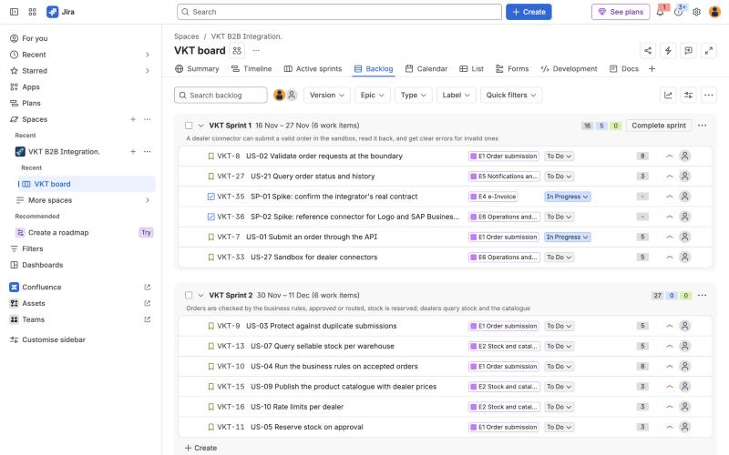

# B2B Order, Stock and Invoice Integration Analysis

[](https://github.com/surakaraali/b2b-order-invoice-integration/actions/workflows/checks.yml)

**Live site: [surakaraali.github.io/b2b-order-invoice-integration](https://surakaraali.github.io/b2b-order-invoice-integration/)** · [API explorer](https://surakaraali.github.io/b2b-order-invoice-integration/api.html)

By **Sura Karaali**, [LinkedIn](https://www.linkedin.com/in/surakaraali/)

A business and technical analysis of a B2B integration between an electronics distributor and the ERP systems of its dealers. It answers the question an integration team asks before building anything: **what has to flow between the systems, in which format, under which rules, and how do we know it worked?**

The project is a complete analysis package, not an implementation: requirements, process models, UML, an API specification, a SOAP contract with a schema-valid e-invoice, a Postman test collection, field mappings, error handling rules, reconciliation SQL on synthetic data, an Agile backlog and wireframes. Everything is presented on a one-page report site in **English and Turkish**; share a direct link such as [`?lang=tr`](https://surakaraali.github.io/b2b-order-invoice-integration/?lang=tr).

> Vektör Elektronik, its dealers and the e-invoice integrator Köprü e-Belge are fictional. The data is synthetic.

---

## The case in one paragraph

Vektör Elektronik distributes consumer electronics to about 120 dealers. Today dealers e-mail Excel orders, sales support keys them into the ERP (about 25 minutes per order), stock is asked by phone (about 60 calls a day) and invoices go out as PDF files that dealers type in again (about 45 reconciliation mismatches a month). The target process: dealers' ERPs, or a portal for small dealers, submit orders and query stock through a REST API; clean orders are approved by business rules in seconds and exceptions go to a sales representative; every shipment is invoiced as e-Fatura through a private integrator over SOAP, and the dealer is notified with the invoice's ETTN so its system can match it automatically.

## Results at a glance

Measured with SQL on 13 weeks of synthetic data after go-live (5 April to 3 July 2027, 3,306 orders), last four weeks against the targets in the BRD:

| Goal | Result | Status |
|---|---|---|
| G1 Order lines through the API or the portal | 74.5%; 76.3% in week 13, up from 8.5% in week 1 | On track, target date October 2027 |
| G2 Orders corrected after entry | 1.02% overall, 0.28% for integrated orders | Met for integrated orders only |
| G3 Time to the first order status | 39 seconds for 95% of orders; 86.6% of approvals within 4 business hours | Met for automatic decisions |
| G4 Stock questions by phone | 29.1 a day, down from about 60 | Not met |
| G5 Invoice in the dealer's inbox | 99.6% on the day of shipment, median 13 minutes | Met |
| G6 Reconciliation mismatches | 1 in June | Met |

Two outages, one in the ERP and one at the integrator, delayed work by up to two hours without losing an order or an invoice. The daily exception report for Monday 5 July lists 14 lines in five groups. The three invoices that came close to the legal 7-day limit were all late because the warehouse confirmed the shipment days after the carrier pickup.

## Deliverables

| Deliverable | Where | Status |
|---|---|---|
| Business requirements document (BRD) | `analysis/01_brd.md` | Done |
| As-is / to-be process analysis with BPMN | `analysis/02_process_as_is_to_be.md`, `diagrams/bpmn/` | Done |
| Use cases and UML (use case, sequence, state) | `analysis/03_use_cases.md`, `diagrams/uml/` | Done |
| Field mapping: dealer ERP ↔ distributor API ↔ UBL-TR | `analysis/04_field_mapping.md`, `analysis/04_field_mapping.xlsx` | Done |
| Error, retry and idempotency scenarios | `analysis/05_error_scenarios.md` | Done |
| Non-functional requirements (SLA, security, performance) | `analysis/06_nfr.md` | Done |
| OpenAPI specification for the dealer API (orders, stock, products, invoices, webhooks) | `api/openapi/vektor-dealer-api.v1.yaml` | Done |
| e-Invoice SOAP contract (WSDL) and sample UBL-TR messages | `api/soap/` | Done |
| Postman collection with tests, sandbox simulator and test report | `api/postman/` | Done |
| Reconciliation and KPI SQL on synthetic integration data (DuckDB) | `data/`, `sql/`, `scripts/` | Done |
| Product backlog, sprint plan, JIRA import and Confluence pages | `agile/` | Done; imported into JIRA Cloud and Confluence, see the screenshots |
| Dealer portal wireframes (draw.io, PNG, SVG for Figma) | `design/wireframes/` | Done |
| One-page report site (EN/TR) and API explorer | `docs/` | Done |
| Automated checks on every push (GitHub Actions) | `.github/workflows/checks.yml` | Done |

## The plan in JIRA

The backlog was imported into JIRA Cloud: 6 epics, 28 stories and 2 spikes in six sprints, with Sprint 1 started. The Confluence space holds the project overview, the requirements index and the decision log. All six screenshots are in [`agile/README.md`](agile/README.md#result).



## How it works

- **Documents** are Markdown files under `analysis/`, written in the order a real project would produce them; each one builds on the one before.
- **Diagrams**: BPMN diagrams, the use case diagram and the wireframes are draw.io files with PNG exports. Sequence and state diagrams are Mermaid text files under `diagrams/uml/`, rendered directly by GitHub and on the site.
- **API contracts**: the REST side is an OpenAPI 3.1 file under `api/openapi/`; the SOAP side is a WSDL with sample envelopes and a UBL-TR invoice under `api/soap/` that validates against the official GİB UBL-TR 1.2.1 schema.
- **Tests**: the Postman collection under `api/postman/` covers the happy path, the negative tests of the error scenarios and the SOAP calls. It runs with Newman against `simulator/sandbox_simulator.py`, a standard library Python test double of the dealer API and the integrator.
- **Data and SQL**: `data/generate_data.py` creates 13 weeks of synthetic orders, invoices and integration logs with problems planted at known rates. `sql/` loads them into DuckDB and produces the daily exception report, the six BRD goal measures and an operational view. `scripts/run_sql.py` runs the queries and writes the results as JSON into `docs/data/` for the site.
- **Site**: `docs/` is plain HTML, CSS and JavaScript with Chart.js, the same approach as the [Telco Customer Churn Analysis](https://github.com/surakaraali/telco-churn-analysis) project. `scripts/sync_site_assets.py` copies the diagrams, wireframes and the OpenAPI file into `docs/assets/`, because GitHub Pages publishes only `docs/`. No build step.
- **Checks**: on every push, GitHub Actions regenerates the data and checks that it is unchanged, runs the SQL and requires every data quality check to pass, and runs the Postman collection against the simulator.

## Running it locally

```bash
python3 -m venv .venv
```

```bash
.venv/bin/pip install -r requirements.txt
```

```bash
.venv/bin/python scripts/run_sql.py
```

```bash
python3 scripts/sync_site_assets.py
```

```bash
python3 -m http.server 8001 -d docs
```

To run the API tests, start `python3 api/postman/simulator/sandbox_simulator.py` and follow `api/postman/README.md`.

## Repository layout

```
b2b-order-invoice-integration/
├── README.md
├── docs/                 # report site (GitHub Pages): index.html, api.html, style.css, app.js, i18n.js
│   ├── assets/           # copies of diagrams, wireframes and the OpenAPI file
│   └── data/             # results.json (SQL) and plan.json (backlog)
├── analysis/             # BRD, process, use cases, mapping, errors, NFR
├── diagrams/
│   ├── bpmn/             # .drawio + .png
│   └── uml/              # use case diagram (.drawio + .png), sequence and state diagrams (.mmd)
├── api/
│   ├── openapi/          # dealer API (OpenAPI 3.1)
│   ├── soap/             # e-Invoice WSDL, sample envelopes, UBL-TR invoice
│   └── postman/          # collection, environments, simulator, test report
├── data/                 # generate_data.py + raw/*.csv (synthetic, 13 weeks)
├── sql/                  # load, data quality, exception report, KPIs, operations
├── scripts/              # run_sql.py (DuckDB → docs/data), sync_site_assets.py
├── agile/                # backlog, sprint plan, JIRA CSV, Confluence pages, screenshots
├── design/
│   └── wireframes/       # five portal and approval screens: .drawio, .png, .svg
├── .github/workflows/    # checks.yml
└── requirements.txt      # duckdb
```

## Status

Started October 2026 and complete: the analysis, the API contracts, the tests, the data and SQL, the plan in JIRA and Confluence, the wireframes and the site.
