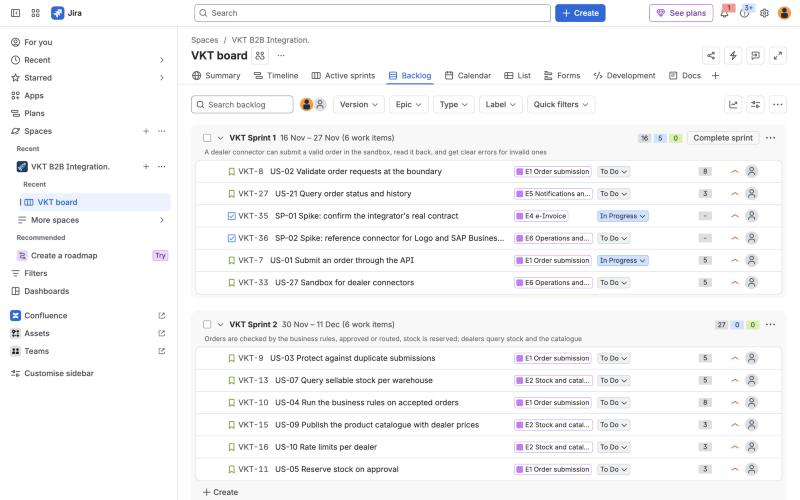

# Agile artefacts

| File | Content |
|---|---|
| `backlog.md` | Product goal, 6 epics, 28 stories and 2 spikes with Gherkin acceptance criteria, priorities, story points, traceability and requirement coverage |
| `sprint_plan.md` | Team, events, release plan to the pilot and go-live, sprints 1 and 2 in detail, Definition of Ready and Done |
| `jira/jira-import.csv` | The same epics and stories in a format the JIRA Cloud CSV importer accepts |
| `confluence/` | Three Confluence pages: project overview, requirements index, decision log |
| `screenshots/` | Screenshots of the JIRA project and the Confluence space |

## Importing into JIRA Cloud

1. Create a free JIRA Cloud site and a **company-managed Scrum** project with the key `VKT`.
2. In the project backlog, create six sprints named exactly `VKT Sprint 1` to `VKT Sprint 6`.
3. Open **Settings, System, External system import, CSV**, and upload `jira/jira-import.csv` with UTF-8 encoding.
4. Map the columns:

| CSV column | JIRA field |
|---|---|
| Issue Id | Issue ID |
| Parent Id | Parent |
| Issue Type | Issue Type |
| Summary | Summary |
| Description | Description |
| Priority | Priority |
| Story Points | Story point estimate |
| Labels | Labels |
| Sprint | Sprint |

5. Check the result: 6 epics, 28 stories and 2 tasks for the spikes, 141 story points in total. If the sprint mapping is not offered, filter by the labels `sprint-1` to `sprint-6` and move the issues with a bulk change.
6. Start `VKT Sprint 1` with the goal from the sprint plan.

## Setting up Confluence

1. Create a space named **VKT B2B Integration**.
2. Create one page per file in `confluence/`. Insert a **Markdown** macro and paste the file, or paste the text directly and fix the tables.
3. On the requirements index, replace the story ids with links to the JIRA issues.

## Result

The backlog was imported into JIRA Cloud on 5 November 2026 (project `VKT`, Scrum, company-managed) and the three pages were published in the Confluence space **VKT B2B Integration**. Sprint 1 is started with the goal from the sprint plan; the epics carry start and due dates from the release plan.

| File | What it shows |
|---|---|
| [`01_jira_backlog.png`](screenshots/01_jira_backlog.png) | The backlog with the six sprints and their stories |
| [`02_jira_board_sprint1.png`](screenshots/02_jira_board_sprint1.png) | The board of the active sprint 1 |
| [`03_jira_timeline.png`](screenshots/03_jira_timeline.png) | The timeline with the six epics |
| [`04_jira_story_us03.png`](screenshots/04_jira_story_us03.png) | US-03 opened, with the Gherkin acceptance criteria |
| [`05_confluence_overview.png`](screenshots/05_confluence_overview.png) | The project overview page |
| [`06_confluence_decision_log.png`](screenshots/06_confluence_decision_log.png) | The decision log page |

### Lessons from the import

- JIRA's new CSV importer joined the space-separated labels into one label (`b2b-integration_e1_sprint-2`); they were split again after the import. Use one `Labels` column per label next time.
- The two spikes are of type Task, and the project's Task screen has no Story Points field, so their 2 points each did not import. JIRA therefore shows 21 points for Sprint 1 against 25 in the plan; adding the field to the screen fixes it.
- Stories, epics, parents, priorities and sprints imported as planned: 36 issues, 141 points, sprint totals 25, 27, 28, 27, 26 and 8.
