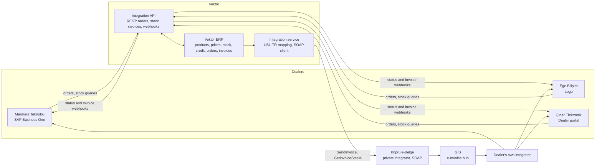

# Business Requirements Document

## B2B Order, Stock and Invoice Integration

| | |
|---|---|
| **Project** | B2B Order, Stock and Invoice Integration |
| **Document** | Business Requirements Document (BRD), version 1.0 |
| **Status** | Approved |
| **Author** | Sura Karaali, Business Analyst |
| **Date** | 29 October 2026 |
| **Related documents** | [02 Process analysis](02_process_as_is_to_be.md), [03 Use cases](03_use_cases.md), [04 Field mapping](04_field_mapping.md), [05 Error scenarios](05_error_scenarios.md), [06 Non-functional requirements](06_nfr.md) |

> All companies, people and figures in this document are fictional. They were created for this portfolio case and are meant to be realistic for a mid-size electronics distributor in Türkiye.

---

## 1. Executive summary

Vektör Elektronik Dağıtım A.Ş. ("Vektör") distributes consumer electronics and small appliances to about 120 dealers across Türkiye. Today, dealer orders arrive by e-mail or as Excel attachments and are keyed into the ERP by the sales support team. Stock availability is answered by phone. Invoices are sent to dealers as PDF attachments, and the dealers key them into their own systems. The process is slow, error-prone and hard to reconcile.

This project replaces the manual exchange with a system-to-system integration:

- Dealers' ERP systems, or a dealer portal for dealers without one, **submit orders** and **query stock** through a REST API.
- Invoices are issued as **e-Fatura** through a private integrator and announced to the dealer with a notification that carries the invoice's ETTN, so the dealer's system can match the invoice to the order automatically.

Three flows are in scope: **order**, **stock inquiry** and **invoice**. Returns and cancellations are out of scope for this version.

## 2. Business context

### 2.1 The company

| Item | Value |
|---|---|
| Business | Distribution of consumer electronics and small appliances to retail dealers |
| Head office | Istanbul |
| Warehouses | Central warehouse in Istanbul, regional warehouses in Ankara and İzmir |
| Dealers | About 120 active dealers |
| Order volume | About 90 orders and 350 order lines per working day |
| Sales support | 3 people, responsible for order entry and dealer questions |
| Sales representatives | 8 regional representatives, each owning a dealer portfolio |
| ERP | Existing on-premise ERP, the system of record for products, prices, stock, credit, orders and invoices. Treated as a black box that exposes this data to the integration layer. |

### 2.2 The dealers

Dealers differ widely in size and in the systems they run. Three representative profiles are used throughout the analysis.

| Profile | Example dealer | System | How they will connect |
|---|---|---|---|
| Large dealer, many branches | Marmara Teknoloji | SAP Business One | Their ERP calls the REST API through a connector |
| Mid-size dealer | Ege Bilişim | Logo | Their ERP calls the REST API through a connector |
| Small dealer, single shop | Çınar Elektronik | No ERP | Uses the Vektör dealer portal, which calls the same API |

### 2.3 The e-Invoice landscape

In Türkiye, invoices between registered e-Invoice taxpayers must be issued electronically in the UBL-TR format and delivered through the Revenue Administration (GİB). Vektör issues its invoices through a **private integrator**, Köprü e-Belge, which accepts invoices over a SOAP web service, signs them and delivers them to GİB. The dealer receives the invoice in its own GİB inbox through its own integrator.

All 120 dealers are registered e-Invoice taxpayers.

## 3. Problem statement

The current process is described in detail in [02 Process analysis](02_process_as_is_to_be.md). The main pains, with the fictional baseline figures used in this case:

| Area | Today | Impact |
|---|---|---|
| Order entry | Orders arrive by e-mail or Excel. Sales support keys them into the ERP, about 25 minutes per order. | About 2 of the 3 sales support staff are busy with order entry. About 4% of orders need a correction after entry (wrong SKU, quantity or address). |
| Order acknowledgement | The dealer learns whether the order was accepted by e-mail, usually the next day. | Dealers call to ask about order status. Rejections due to credit limit are discovered late. |
| Stock inquiry | About 60 stock questions a day by phone or e-mail. | Sales support time. Dealers order items that are not available, so about 7% of order lines end up on backorder. |
| Invoice delivery | Invoices are sent as PDF by e-mail. The dealer keys them into its own system. | Average 1.5 working days from shipment to the dealer booking the invoice. About 45 reconciliation mismatches per month (wrong amounts, missing invoices, duplicates). |
| Visibility | Nobody has a single view of where an order or invoice stands. | Monthly reconciliation takes finance about 3 working days. |

## 4. Goals and success metrics

Targets are measured 6 months after go-live.

| ID | Goal | Metric | Baseline | Target |
|---|---|---|---|---|
| G1 | Remove manual order entry | Share of order lines received through the API or the portal | 0% | At least 80% |
| G2 | Reduce order errors | Orders corrected after entry | 4% | Below 0.5% |
| G3 | Faster acknowledgement | Time from submission to first status | About 1 working day | Under 2 minutes for automatic decisions, under 4 business hours when approval is needed |
| G4 | Self-service stock | Stock questions handled by phone or e-mail | About 60 per day | Below 6 per day |
| G5 | Faster invoice matching | Time from shipment to the dealer booking the invoice | 1.5 working days | Same day. Notification within 1 hour of GİB delivery |
| G6 | Fewer reconciliation issues | Mismatches per month | About 45 | Below 5 |

## 5. Stakeholders

| Role | Who | Interest | Involvement |
|---|---|---|---|
| Sponsor | Sales Director | Lower cost to serve, dealer satisfaction | Approves scope and go-live |
| Business owner | Sales Operations Manager | Process design, approval rules | Approves requirements |
| Sales support | 3-person team | Less keying, fewer calls | Consulted. Main source for the as-is process |
| Sales representatives | 8 regional representatives | Approval queue, visibility of their dealers' orders | Consulted |
| Warehouse and logistics | 3 warehouses | Correct allocations, shipment events | Consulted |
| Finance and accounting | Finance team | Correct invoices, easy reconciliation | Approves invoice rules |
| IT and integration team | Internal IT | Builds and operates the integration | Responsible for delivery |
| Dealers | The three profiles above | Easy connection, fast answers | Consulted. Two pilot dealers |
| Private integrator | Köprü e-Belge | SOAP contract, service levels | External party |
| GİB | Revenue Administration | Regulatory format and delivery | External, indirect |

## 6. Scope

### 6.1 In scope

- A REST API for dealers to submit orders, query order status and query stock.
- Automatic validation of orders against the catalogue, the dealer's price list, minimum order quantities, credit limit and stock.
- A hybrid approval model: automatic approval when all checks pass, sales representative approval otherwise.
- Status notifications to dealers by webhook, with query endpoints as a fallback.
- Automatic issuing of e-Fatura invoices through the private integrator when an order is shipped.
- An invoice-issued notification to the dealer carrying the ETTN, so the dealer's system can match the invoice to the order.
- A dealer portal for dealers without an ERP, using the same API.
- A daily reconciliation report for the integration and finance teams.
- Onboarding of dealers: API credentials, price list assignment, shipping warehouse assignment.

### 6.2 Out of scope for this version

- Returns and cancellations after approval.
- The "Ticari" invoice scenario, where the dealer can accept or reject the invoice through GİB.
- e-İrsaliye (electronic delivery note).
- Payments and collections.
- Development of connectors on the dealer side (Logo, SAP Business One). Vektör publishes the API specification and a Postman collection; the connector is the dealer's responsibility (see open question Q1).
- Quotes, price negotiation, campaigns and discounts beyond the dealer's price list.

## 7. Solution overview

### 7.1 System context

### 7.2 Order flow

1. **Submission.** The dealer's ERP or the portal calls `POST /orders` with the dealer code, the dealer's own order number, the order lines (SKU and quantity) and the delivery address. The request carries the dealer's OAuth2 access token and an `Idempotency-Key` header.
2. **Validation.** The API authenticates the caller and validates the request against the schema. An invalid request is answered with HTTP 400 and a list of error codes. No order is created.
3. **Duplicate protection.** A repeated request with the same `Idempotency-Key` from the same dealer receives the original response. No second order is created.
4. **Registration.** The order is stored with status `RECEIVED`. The API answers with HTTP 202 Accepted, the Vektör order number and the status.
5. **Business rule checks.** Each SKU must be active and present in the dealer's price list, each line must meet the minimum order quantity, the open balance plus the order total must stay within the credit limit, and stock must be available in the dealer's shipping warehouse.
6. **Decision.** If every check passes, the order becomes `APPROVED`, stock is reserved and the order becomes `ALLOCATED`. If the credit limit is exceeded or stock is partial, the order becomes `PENDING_APPROVAL` and a task is created for the dealer's sales representative, who approves, approves with reduced quantities, or rejects with a reason code.
7. **Notification.** Every status change is sent to the dealer as a webhook. The dealer can also query `GET /orders/{orderId}`.
8. **Shipment.** When the warehouse ships the goods, the order becomes `SHIPPED` and the delivery note number and tracking number are attached. Shipment triggers the invoice flow.

### 7.3 Stock inquiry flow

1. **Query.** The dealer calls `GET /stock` with one or more SKUs.
2. **Answer.** For each SKU, the sellable quantity per warehouse (on hand minus reserved), the unit, and the expected receipt date if a purchase order is open.
3. **Rules.** Requests are rate-limited per dealer, answers may be up to 5 minutes old, and unknown SKUs are returned flagged as `UNKNOWN` without failing the whole request.

### 7.4 Invoice flow

1. **Invoice creation.** When the shipment is confirmed, the ERP creates the invoice and generates its ETTN.
2. **Transformation.** The integration service maps the invoice to a UBL-TR XML document. This version uses the "Temel" scenario, which has no accept or reject step.
3. **Sending.** The integration service calls the integrator's SOAP `SendInvoice` operation. The integrator answers with a receipt number, or with an error such as a schema violation or a dealer tax number that is not on the GİB registered-user list.
4. **Status tracking.** The integration service polls `GetInvoiceStatus` by ETTN until the invoice is `DELIVERED` to the dealer's GİB inbox, or reports `ERROR`.
5. **Notification.** On `DELIVERED`, the order becomes `INVOICED` and the dealer receives an `invoice.issued` webhook carrying the ETTN, invoice number, Vektör order number, dealer order number and totals. `GET /invoices` is available as a fallback.
6. **Matching.** The dealer's system downloads the invoice from its own integrator and matches it to the order by ETTN. The order becomes `CLOSED` when the dealer acknowledges the match, or automatically 30 days after `INVOICED`.
7. **Error path.** On `ERROR`, the integration team is alerted, the cause is fixed and the invoice is resent. A tax number problem creates a task for sales support.

### 7.5 Order statuses

| Status | Meaning | Set by | Possible next statuses |
|---|---|---|---|
| `RECEIVED` | Accepted by the API, business rules not yet checked | API | `APPROVED`, `PENDING_APPROVAL`, `REJECTED` |
| `PENDING_APPROVAL` | Waiting for a sales representative decision (credit limit or stock) | Rules engine | `APPROVED`, `REJECTED` |
| `APPROVED` | Approved, stock reservation in progress | Rules engine or sales representative | `ALLOCATED` |
| `ALLOCATED` | Stock reserved in the shipping warehouse | ERP | `SHIPPED` |
| `SHIPPED` | Goods left the warehouse, delivery note and tracking number attached | Warehouse | `INVOICED` |
| `INVOICED` | e-Invoice delivered to the dealer's GİB inbox | Integration service | `CLOSED` |
| `CLOSED` | Dealer acknowledged the invoice match, or 30 days passed since `INVOICED` | Dealer or timer | None |
| `REJECTED` | Rejected at validation or by a sales representative, with a reason code | API or sales representative | None |

### 7.6 Reconciliation

A daily report lists three exception groups so that nothing silently stalls:

- Orders `SHIPPED` for more than 1 working day without an invoice.
- Invoices sent to the integrator but not `DELIVERED` within 24 hours.
- Invoices `DELIVERED` but not acknowledged by the dealer within 5 working days.

The report is produced with SQL on the integration data. The queries are the subject of the `sql/` folder.

## 8. Business requirements

Priorities follow MoSCoW: Must, Should, Could, Won't (this version).

| ID | Requirement | Flow | Priority |
|---|---|---|---|
| BR-01 | Dealers can submit orders from their own ERP or from the dealer portal without anyone re-keying them. | Order | Must |
| BR-02 | Every submitted order receives an immediate acknowledgement with a Vektör order number. | Order | Must |
| BR-03 | A duplicate submission of the same order never creates a second order. | Order | Must |
| BR-04 | Orders are validated automatically against the catalogue, the dealer's price list, minimum order quantities, credit limit and stock. | Order | Must |
| BR-05 | Orders that pass every check are approved automatically. Orders that fail the credit or stock check go to the dealer's sales representative for a decision. | Order | Must |
| BR-06 | Dealers are informed of every order status change, and can query the status at any time. | Order | Must |
| BR-07 | Dealers can query sellable stock per SKU and warehouse. | Stock | Must |
| BR-08 | An e-Fatura invoice is issued through the private integrator automatically when an order is shipped. | Invoice | Must |
| BR-09 | Dealers receive an invoice-issued notification that carries the ETTN and the order numbers, so their system can match the invoice automatically. | Invoice | Must |
| BR-10 | The integration and finance teams receive a daily reconciliation report of stalled orders and invoices. | All | Must |
| BR-11 | Dealers without an ERP can do everything above through a dealer portal. | All | Should |
| BR-12 | A sales representative can approve an order with reduced quantities. | Order | Should |
| BR-13 | The stock answer includes the expected receipt date for items that are not available. | Stock | Could |
| BR-14 | A dealer can acknowledge that an invoice was matched, which closes the order. | Invoice | Could |
| BR-15 | Returns, cancellations after approval, and the "Ticari" invoice scenario. | All | Won't (this version) |

## 9. Business rules

| ID | Rule | Flow |
|---|---|---|
| RULE-01 | Orders are accepted only from active dealers with valid API credentials. A suspended dealer receives a rejection with reason `DEALER_SUSPENDED`. | Order |
| RULE-02 | Every order line must reference an SKU that is active in the catalogue and present in the dealer's price list on the order date. Otherwise the whole order is rejected with reason `INVALID_SKU`. | Order |
| RULE-03 | Prices come from the dealer's price list on the Vektör side. The dealer does not send prices. | Order |
| RULE-04 | Each SKU has a minimum order quantity. A line below it rejects the order with reason `BELOW_MOQ`. | Order |
| RULE-05 | Credit check: the dealer's open balance plus the order total including VAT must not exceed the credit limit. Otherwise the order goes to `PENDING_APPROVAL` with reason `CREDIT_LIMIT`. | Order |
| RULE-06 | Stock check: every line must be fully available as sellable stock in the dealer's shipping warehouse. If any line is partially available or not available, the order goes to `PENDING_APPROVAL` with reason `PARTIAL_STOCK`. | Order |
| RULE-07 | Stock is reserved only when an order reaches `APPROVED`. Orders in `PENDING_APPROVAL` do not reserve stock. | Order |
| RULE-08 | A pending approval must be decided within 4 business hours. After that, the task is escalated to the sales manager. | Order |
| RULE-09 | A sales representative can approve the full order, approve with reduced quantities, or reject with a reason code. Reduced quantities are reported to the dealer in the status change. | Order |
| RULE-10 | The `Idempotency-Key` is unique per dealer and kept for 7 days. A repeat within that period returns the original response and creates nothing. | Order |
| RULE-11 | Stock queries are limited to 60 requests per minute per dealer. Stock figures may be up to 5 minutes old. | Stock |
| RULE-12 | Unknown SKUs in a stock query are returned flagged as `UNKNOWN`. The request still succeeds. | Stock |
| RULE-13 | One invoice is issued per shipment, on the shipment date, using the "Temel" scenario. | Invoice |
| RULE-14 | Before an invoice is sent, the dealer's tax number (VKN) must be on the GİB registered-user list. Otherwise the invoice is held and a task is created for sales support. | Invoice |
| RULE-15 | An order becomes `INVOICED` only when the integrator reports `DELIVERED`. Until then the invoice counts as in transit. | Invoice |
| RULE-16 | Webhooks are retried 5 times with increasing delays (1, 5, 15, 60 and 240 minutes). After the last failure the event stays available through the query endpoints and the dealer appears in the daily report. | All |

## 10. Data requirements

High-level entities. Field-level detail is in [04 Field mapping](04_field_mapping.md).

| Entity | Key attributes | System of record |
|---|---|---|
| Dealer | Dealer code, name, tax number (VKN), credit limit, open balance, price list, shipping warehouse, status, API client | ERP |
| Product (SKU) | SKU, name, unit, VAT rate, minimum order quantity, status | ERP |
| Price list | Price list id, SKU, unit price, validity period | ERP |
| Stock balance | Warehouse, SKU, on hand, reserved, expected receipt date | ERP |
| Order and order line | Vektör order number, dealer order number, idempotency key, status, reason code. Per line: SKU, requested quantity, approved quantity, unit price | Integration database and ERP |
| Invoice and invoice line | Invoice number, ETTN, date, order number, totals, integrator status. Per line: SKU, quantity, unit price, VAT | ERP and integration database |
| Integration log | Timestamp, flow, direction, dealer, request id, result, error code, latency | Integration database |
| Webhook delivery | Event, dealer, attempt number, result, next retry time | Integration database |

## 11. Non-functional requirements

Detailed in [06 Non-functional requirements](06_nfr.md). Headline expectations:

- Availability of the API of 99.5% during business hours (08:00 to 20:00, Monday to Saturday).
- Order submission answered within 2 seconds, stock queries within 1 second, at the expected peak of 30 requests per minute.
- Every request and every integrator call is logged with a request id, so an order or invoice can be traced end to end.
- Invoice documents and logs are retained according to the legal retention periods for commercial and tax records.
- Dealer data is isolated: a dealer can only see its own orders, invoices and price list.

## 12. Assumptions

- All 120 dealers are registered e-Invoice taxpayers.
- Vektör's ERP can expose products, prices, stock balances, credit data, orders and invoices to the integration layer through its existing interfaces.
- The integrator's SOAP service supports sending UBL-TR invoices and querying their status by ETTN.
- API credentials for dealers are issued by the IT team during onboarding.
- Dealers that run Logo or SAP Business One connect through a connector built on their side or by a partner (see Q1).
- The sales representatives' task queue can be provided by the existing CRM or by a simple screen in the integration layer.

## 13. Constraints

- The UBL-TR format and the GİB delivery rules are fixed by regulation. The SOAP contract is fixed by the integrator.
- Vektör does not change the dealers' ERP systems.
- The existing ERP stays the system of record. The integration layer does not keep its own copy of prices or stock.
- Fictional timeline: pilot with two dealers in the first quarter of 2027, go-live for all dealers in the second quarter of 2027.

## 14. Risks

| ID | Risk | Likelihood | Impact | Mitigation |
|---|---|---|---|---|
| R1 | Dealers delay their connector work, so adoption stalls. | High | High | Pilot with two dealers. Publish the OpenAPI file and the Postman collection early. Offer the portal as a fallback. |
| R2 | An integrator outage blocks invoicing. | Medium | High | Queue invoices and retry. Alert the integration team. Manual sending from the integrator's portal as a contingency. |
| R3 | Open balance and credit limit data in the ERP are not current, so the credit check gives wrong results. | Medium | Medium | Refresh credit data when payments are posted. Sales representatives can override through the approval step. |
| R4 | Product master data is incomplete (inactive SKUs, missing minimum order quantities). | Medium | Medium | Data quality check before go-live, with a validation report. |
| R5 | A dealer's tax number is missing from the GİB registered-user list or changes. | Low | Medium | Check at onboarding and before every send (RULE-14). |
| R6 | Dealer-side retries create duplicate orders. | Medium | High | Mandatory idempotency key (RULE-10). |
| R7 | Small dealers do not adopt the portal. | Medium | Low | Simple portal design, training, sales representative follow-up. |

## 15. Open questions

| ID | Question | Owner | Needed by |
|---|---|---|---|
| Q1 | Will Vektör provide a reference connector for Logo and SAP Business One, or will dealers and partners build their own? | IT | Before the pilot |
| Q2 | Backorder policy: should a partially available line stay on the order, or be removed and reordered later? | Sales Operations | Requirements sign-off |
| Q3 | Should the next version adopt the "Ticari" invoice scenario, where the dealer can accept or reject within 8 days? | Finance | Next version planning |
| Q4 | Can the open balance be refreshed in near real time when a payment is posted? | Finance and IT | Design |
| Q5 | Is the dealer acknowledgement in BR-14 needed, or is the 30-day automatic close enough? | Sales Operations | Requirements sign-off |

## 16. Glossary

| Term | Meaning |
|---|---|
| BRD | Business Requirements Document, this document. |
| Dealer | A retail company that buys from Vektör and sells to consumers. |
| ERP | Enterprise Resource Planning system, the system of record for products, prices, stock, orders and invoices. |
| e-Fatura | Electronic invoice in Türkiye, mandatory between registered e-Invoice taxpayers, delivered through GİB. |
| ETTN | Unique invoice identifier (a UUID) carried by every e-Fatura document. |
| GİB | Gelir İdaresi Başkanlığı, the Turkish Revenue Administration, which runs the e-Invoice hub. |
| Idempotency-Key | A unique value sent with an order request so that a repeated request does not create a second order. |
| Minimum order quantity (MOQ) | The smallest quantity of an SKU that can be ordered. |
| OAuth2 client credentials | The authentication method for the API. Each dealer has its own client id and secret and obtains an access token. |
| Private integrator (Özel Entegratör) | A GİB-certified company that signs and delivers e-Invoices on behalf of taxpayers. |
| REST | The API style used for the order and stock flows, over HTTPS with JSON. |
| Sellable stock | Stock on hand minus stock reserved for approved orders. |
| SKU | Stock keeping unit, the product code. |
| SOAP | The XML web service protocol used by the integrator. |
| Temel, Ticari | The two e-Fatura scenarios. "Temel" has no response step. "Ticari" lets the recipient accept or reject the invoice within 8 days. |
| UBL-TR | The Turkish profile of the UBL XML standard, the mandatory e-Invoice format. |
| VKN | Vergi Kimlik Numarası, the company tax number. |
| Webhook | An HTTP call from Vektör to a URL registered by the dealer, used to push status and invoice events. |
