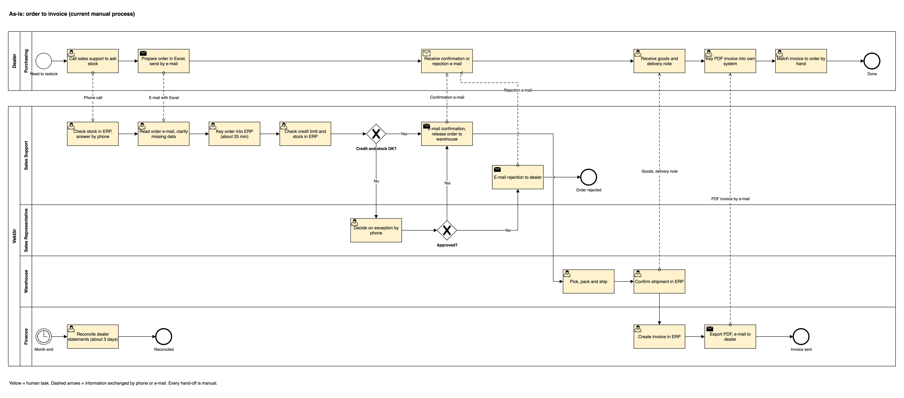
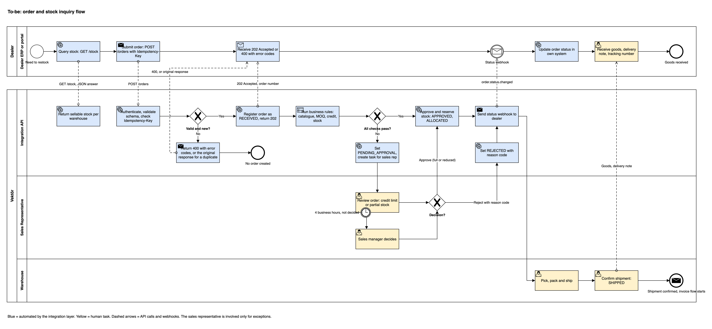
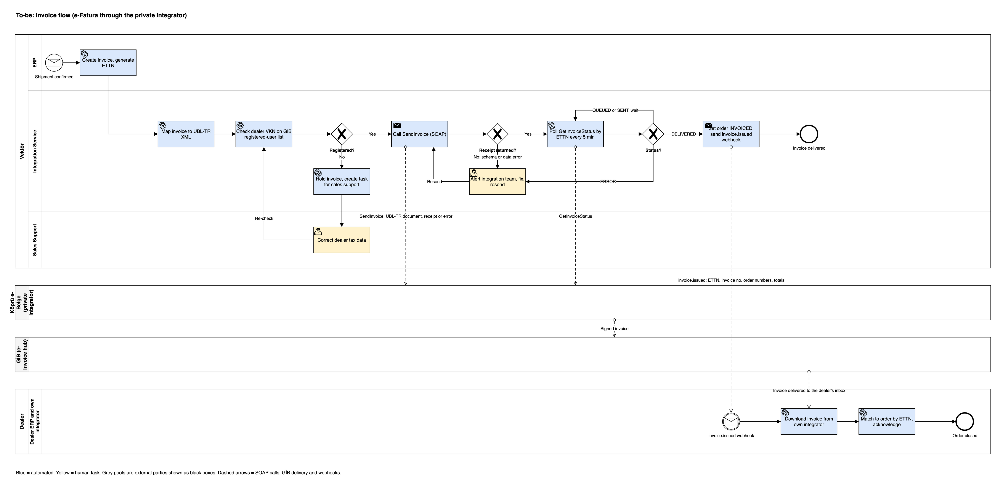

# Process Analysis: As-Is and To-Be

## B2B Order, Stock and Invoice Integration

| | |
|---|---|
| **Project** | B2B Order, Stock and Invoice Integration |
| **Document** | Process analysis, version 1.0 |
| **Status** | Approved |
| **Author** | Sura Karaali, Business Analyst |
| **Date** | 29 October 2026 |
| **Related documents** | [01 BRD](01_brd.md), [03 Use cases](03_use_cases.md), [05 Error scenarios](05_error_scenarios.md) |
| **Diagrams** | `diagrams/bpmn/` (draw.io source files and PNG exports) |

> All companies, people and figures in this document are fictional. They were created for this portfolio case and are internally consistent with the [BRD](01_brd.md).

---

## 1. Purpose and method

This document describes how Vektör and its dealers work today (as-is), where that process loses time and money, and how the integrated process will work (to-be). It is the basis for the use cases, the API design and the change plan.

The as-is process was reconstructed the way it would be in a real engagement:

- Semi-structured interviews with the three sales support staff, two sales representatives, the warehouse supervisor and the finance team.
- A walk-through of 20 orders sampled from one week, following each order from the dealer's e-mail to the booked invoice.
- E-mail and ERP timestamps of the sampled orders, used to estimate waiting and handling times.

In this portfolio case the interviews and the sample are fictional. The figures below are assumptions, chosen so that the step-level estimates add up to the baseline numbers in the BRD.

Notation: diagrams use BPMN 2.0 at an analytical level of detail. Pools are organisations, lanes are roles or systems, solid arrows are sequence flows inside an organisation, dashed arrows are messages between organisations. Yellow tasks are done by people, blue tasks are automated.

## 2. Actors and systems

| Actor or system | Pool | As-is role | To-be role |
|---|---|---|---|
| Dealer purchasing | Dealer | Calls for stock, prepares orders in Excel, keys invoices in | Works in own ERP or the dealer portal, which call the API |
| Dealer ERP or portal | Dealer | Not connected | Sends orders and stock queries, receives webhooks |
| Sales support | Vektör | Answers stock calls, keys orders into the ERP, e-mails confirmations and PDF invoices | Handles exceptions: dealer onboarding, tax data corrections, portal help |
| Sales representative | Vektör | Decides credit and stock exceptions by phone, ad hoc | Decides exceptions in a task queue with a 4 business hour target |
| Warehouse | Vektör | Picks, packs, ships, confirms shipment in the ERP | Same, but shipment confirmation now triggers invoicing and the dealer notification |
| Finance | Vektör | Creates invoices, e-mails PDFs, reconciles monthly | Reviews the daily exception report; invoices are created automatically |
| ERP | Vektör | System of record, operated by hand | System of record, fed and read by the integration layer |
| Integration API and service | Vektör | Does not exist | Validates orders, runs business rules, calls the integrator, sends webhooks |
| Köprü e-Belge | External | Not used for dealer invoices | Signs and delivers e-Fatura documents to GİB |
| GİB | External | Not in the flow | Delivers the invoice to the dealer's inbox |

## 3. As-is process

Source: `diagrams/bpmn/01_as_is_order_to_invoice.drawio`

### 3.1 Steps

| # | Step | Actor | Tool | Handling time | Waiting time | What goes wrong |
|---|---|---|---|---|---|---|
| 1 | Dealer calls sales support to ask whether items are in stock | Dealer, sales support | Phone, ERP | 5 min per call, about 60 calls a day | Call-backs when the line is busy | The answer is a snapshot; by the time the order arrives the stock may be gone |
| 2 | Dealer prepares the order in Excel and e-mails it | Dealer | Excel, e-mail | 15 min | None | Free format: wrong or old SKU codes, missing delivery address, quantities below the minimum |
| 3 | Sales support reads the e-mail and clarifies missing data | Sales support | E-mail, phone | 3 min, plus a 10 min call for 1 order in 5 | E-mails are handled in batches, 2 to 4 hours | Clarification calls go unanswered, the order waits until the next day |
| 4 | Sales support keys the order into the ERP | Sales support | ERP | 15 min on average for 8 lines (SKU search, price check, address) | None | Typing errors in SKU, quantity or address: about 4% of orders need a correction later |
| 5 | Sales support checks credit limit and stock in the ERP | Sales support | ERP | 2 min | None | Open balance in the ERP lags payments by a day, so good dealers are blocked |
| 6 | Sales representative decides exceptions by phone | Sales representative | Phone | 10 min | Half a day on average, representatives are on the road | No record of who decided what and why |
| 7 | Sales support e-mails confirmation or rejection | Sales support | E-mail | 3 min | None | Dealer learns the result the next day; rejections come as a surprise |
| 8 | Warehouse picks, packs and ships; confirms shipment in the ERP | Warehouse | ERP, carrier portal | Not changed by this project | None | Shipment confirmation is sometimes a day late, which delays the invoice |
| 9 | Finance creates the invoice in the ERP, exports a PDF and e-mails it | Finance | ERP, e-mail | 4 min per invoice | Invoices are produced once a day | Wrong recipient address, PDF forgotten, duplicate send after a dealer query |
| 10 | Dealer keys the PDF invoice into its own system and matches it to the order | Dealer | Own ERP | 10 min | 1.5 working days on average from shipment to booking | Amount or quantity typed wrong; invoice matched to the wrong order |
| 11 | Finance reconciles dealer statements at month end | Finance, dealer | Excel, ERP | About 3 working days a month | Monthly | About 45 mismatches a month: wrong amounts, missing invoices, duplicates |

### 3.2 Where the time goes

Per working day, with 45 orders and about 60 stock calls:

| Activity | Calculation | Hours a day |
|---|---|---|
| Stock calls | 60 calls × 5 min | 5.0 |
| Reading and clarifying order e-mails | 45 × 3 min + 9 calls × 10 min | 3.8 |
| Keying orders into the ERP | 45 × 15 min | 11.3 |
| Credit and stock check, confirmation e-mails | 45 × 5 min | 3.8 |
| **Order handling subtotal** | 45 × 25 min | **18.9 hours, about 2.4 of the 3 staff** |
| **Sales support total** | | **23.9 hours, the whole team** |
| Invoice export and e-mail (finance) | 45 × 4 min | 3.0 |
| Dealer side: order preparation and invoice keying | 45 × 25 min, spread over 120 dealers | 18.8 |

Sales support spends almost all of its capacity on moving information from one system or e-mail into another. The elapsed time from the dealer's e-mail to a confirmation is about one working day, and most of it is waiting: the e-mail batch, the clarification call and the representative's decision.

## 4. Pain points and root causes

| Pain point | Baseline (BRD) | Root cause | Where it is fixed in the to-be process |
|---|---|---|---|
| Order entry consumes most of sales support | About 2 of 3 staff | Orders arrive as free-format Excel and must be re-keyed | Orders arrive structured through the API or the portal and are validated automatically |
| Orders need corrections after entry | 4% of orders | Manual re-keying; no validation of SKU, quantity and address at the source | Schema validation, catalogue and minimum quantity checks at submission; the dealer gets the error codes immediately |
| Dealers learn the order result late | About 1 working day | Batch handling, phone-based exceptions, confirmation by e-mail | Immediate acknowledgement, automatic approval for clean orders, status webhooks |
| Stock questions by phone | About 60 a day | No self-service view of sellable stock | Stock query endpoint with sellable quantity per warehouse |
| Items ordered that are not available | 7% of lines on backorder | Stock answer is a snapshot taken before the order is keyed | Stock is checked at submission and reserved at approval |
| Credit exceptions block good dealers | Part of the pending orders | Open balance in the ERP lags payments | Credit data refreshed when payments are posted; representative can override (BRD Q4) |
| Invoices booked late by dealers | 1.5 working days | PDF by e-mail, keyed in by hand | e-Fatura delivered through GİB plus a webhook carrying the ETTN for automatic matching |
| Reconciliation mismatches | About 45 a month, 3 days of finance time | Typing errors on both sides, duplicate PDFs, invoices lost in mailboxes | Single invoice per shipment, delivered once, matched by ETTN; daily exception report |
| No visibility of where an order or invoice stands | Monthly surprise | No shared status, no log | Order statuses, integration log, daily report |

## 5. To-be process

### 5.1 Order and stock inquiry

Source: `diagrams/bpmn/02_to_be_order_and_stock.drawio`

| # | Step | Actor | Automation | Target time | Notes |
|---|---|---|---|---|---|
| 1 | Dealer queries sellable stock | Dealer ERP or portal, Integration API | Automatic | Under 1 second | Sellable = on hand minus reserved, per warehouse, up to 5 minutes old (RULE-11) |
| 2 | Dealer submits the order with an `Idempotency-Key` | Dealer ERP or portal | Automatic | Immediate | Portal users fill a form; the portal calls the same API |
| 3 | API authenticates, validates the schema, checks the idempotency key | Integration API | Automatic | Under 2 seconds | Invalid: HTTP 400 with error codes, no order created. Duplicate: original response (RULE-10) |
| 4 | Order registered as `RECEIVED`, HTTP 202 with the order number | Integration API | Automatic | Under 2 seconds | The dealer has a reference from the first second |
| 5 | Business rules: catalogue, price list, minimum quantity, credit, stock | Integration API, ERP | Automatic | Under 1 minute | RULE-01 to RULE-06 |
| 6a | All checks pass: `APPROVED`, stock reserved, `ALLOCATED` | Integration API, ERP | Automatic | Under 1 minute | RULE-07 |
| 6b | Credit or stock exception: `PENDING_APPROVAL`, task for the representative | Integration API | Automatic | Under 1 minute | Reason `CREDIT_LIMIT` or `PARTIAL_STOCK` |
| 7 | Representative approves, approves reduced quantities, or rejects | Sales representative | Human decision | Within 4 business hours | Escalated to the sales manager after 4 business hours (RULE-08, RULE-09) |
| 8 | Status webhook to the dealer on every change | Integration API | Automatic | Seconds | Retried 5 times (RULE-16); `GET /orders/{orderId}` as fallback |
| 9 | Warehouse picks, packs, ships, confirms `SHIPPED` | Warehouse | Human | Same as today | Confirmation now triggers the invoice flow and the dealer notification |

### 5.2 Invoice

Source: `diagrams/bpmn/03_to_be_invoice.drawio`

| # | Step | Actor | Automation | Target time | Notes |
|---|---|---|---|---|---|
| 1 | ERP creates the invoice and the ETTN on shipment confirmation | ERP | Automatic | Minutes | One invoice per shipment (RULE-13) |
| 2 | Integration service maps the invoice to UBL-TR | Integration service | Automatic | Seconds | "Temel" scenario in this version |
| 3 | Dealer tax number checked against the GİB registered-user list | Integration service | Automatic | Seconds | Not registered: invoice held, task for sales support (RULE-14) |
| 4 | `SendInvoice` call to Köprü e-Belge | Integration service | Automatic | Seconds | Receipt number, or an error that alerts the integration team |
| 5 | Status polled by ETTN until `DELIVERED` or `ERROR` | Integration service | Automatic | Every 5 minutes | Typical delivery well under 1 hour |
| 6 | Order set to `INVOICED`, `invoice.issued` webhook to the dealer | Integration service | Automatic | Seconds after delivery | Carries ETTN, invoice number, both order numbers and totals (RULE-15) |
| 7 | Dealer downloads the invoice from its own integrator and matches by ETTN | Dealer ERP | Automatic for connected dealers | Same day | Portal dealers download from their integrator's portal and match by hand |
| 8 | Dealer acknowledges, or the order closes after 30 days | Dealer ERP, timer | Automatic | 30 days at most | BR-14 is optional (BRD Q5) |
| 9 | Exceptions reviewed from the daily report | Integration team, finance | Human | Daily | Shipped but not invoiced, not delivered within 24 hours, not acknowledged within 5 working days |

## 6. As-is versus to-be

| Measure | As-is | To-be |
|---|---|---|
| Steps from the dealer's need to a confirmed order | 7 | 4, of which 2 on the dealer side |
| Manual touchpoints per order at Vektör | 5: stock call, read e-mail, key order, check, e-mail result | 0 for a clean order, 1 for an exception |
| Sales support effort per order | About 25 min of handling, plus about 7 min of stock calls | About 2 min, for exceptions only |
| Time to acknowledgement | About 1 working day | Under 2 minutes; under 4 business hours when approval is needed |
| Stock information | By phone, snapshot, about 60 calls a day | Self-service, per warehouse, up to 5 minutes old |
| Order status visibility | None outside the ERP | Status per order, queryable, pushed by webhook |
| Decision record for exceptions | Phone call, no record | Task with reason code, decided by, decided at |
| Invoice delivery | PDF by e-mail, keyed in by the dealer | e-Fatura through GİB, webhook with ETTN, matched automatically |
| Shipment to dealer booking | 1.5 working days | Same day |
| Reconciliation | Monthly, 3 days, about 45 mismatches | Daily exception report; target under 5 mismatches a month |
| Systems in the flow | ERP, Excel, e-mail, phone | Dealer ERP or portal, Integration API, ERP, integrator, GİB |

What does not change: the ERP stays the system of record, the warehouse process stays as it is, and the sales representative still owns credit and stock exceptions. The project removes re-keying and waiting, not decisions.

## 7. Change impact

| Role | What changes | Support needed |
|---|---|---|
| Sales support | Order keying and stock calls disappear for connected dealers. The role shifts to dealer onboarding, portal help, tax data corrections and the daily exception report. About 2 staff-equivalents of capacity are freed; during rollout this capacity goes to onboarding dealers. | Role description, onboarding checklist, exception handling guide |
| Sales representatives | Exceptions arrive in a task queue with a 4 business hour target instead of ad hoc phone calls. Reason codes must be chosen. | Task screen in the CRM or the integration layer, training on reason codes |
| Warehouse | Shipment confirmation must be entered the same day, because it now triggers the invoice and the dealer notification. | Short instruction; shipment confirmation delay added to the daily report |
| Finance | Invoices are created automatically on shipment; the team reviews exceptions instead of exporting PDFs. Month-end reconciliation shrinks. | Exception report walkthrough, agreed handling of held invoices |
| IT and integration team | New operational duties: integrator status, webhook failures, dealer credentials, log monitoring. | Runbook, monitoring dashboards (see [06 NFR](06_nfr.md)) |
| Dealers | Connected dealers need a connector in their ERP; small dealers move from e-mail to the portal. | API specification, Postman collection, portal training, pilot with two dealers |

## 8. Process KPIs and how they are measured

| BRD goal | KPI | Measured from | Frequency |
|---|---|---|---|
| G1 Remove manual order entry | Share of order lines received through the API or the portal | Integration log: orders by channel | Weekly |
| G2 Reduce order errors | Orders corrected after entry | ERP: order change log | Monthly |
| G3 Faster acknowledgement | Time from `RECEIVED` to `APPROVED`, `PENDING_APPROVAL` or `REJECTED`; time from `PENDING_APPROVAL` to decision | Integration log: status timestamps | Weekly |
| G4 Self-service stock | Stock questions by phone or e-mail | Sales support tally; stock query count from the integration log | Monthly |
| G5 Faster invoice matching | Time from `SHIPPED` to `INVOICED`; time from `INVOICED` to dealer acknowledgement | Integration log | Weekly |
| G6 Fewer reconciliation issues | Mismatches per month | Finance reconciliation; daily exception report | Monthly |

## 9. Open points

| ID | Point | Owner | Needed by |
|---|---|---|---|
| P1 | Cut-over: parallel run for the two pilot dealers, or a hard switch per dealer on onboarding day | Sales Operations, IT | Pilot plan |
| P2 | Orders that still arrive by e-mail after go-live: keyed by sales support into the portal on behalf of the dealer, or refused after a grace period | Sales Operations | Requirements sign-off |
| P3 | Who runs the dealer portal help desk during rollout | Sales Operations | Pilot plan |
| P4 | Backorder policy for partially available lines (BRD Q2) | Sales Operations | Requirements sign-off |
| P5 | Whether a dealer acknowledgement of the invoice is required (BRD Q5) | Sales Operations | Requirements sign-off |
