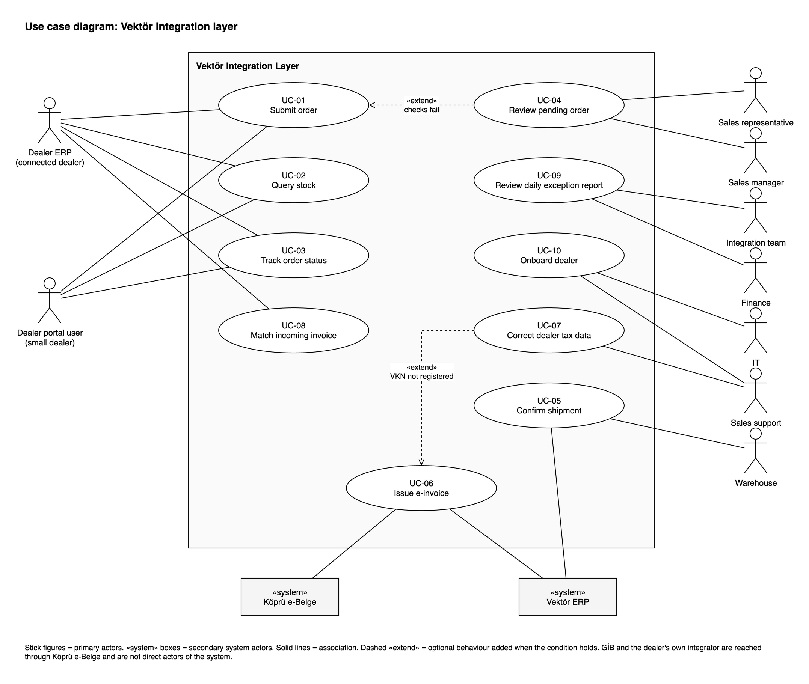
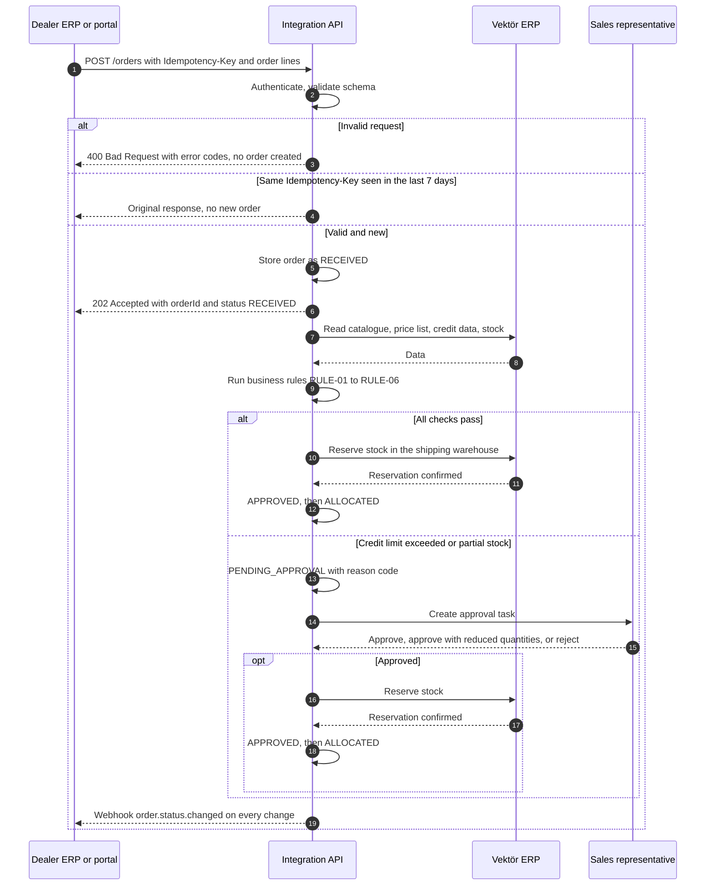
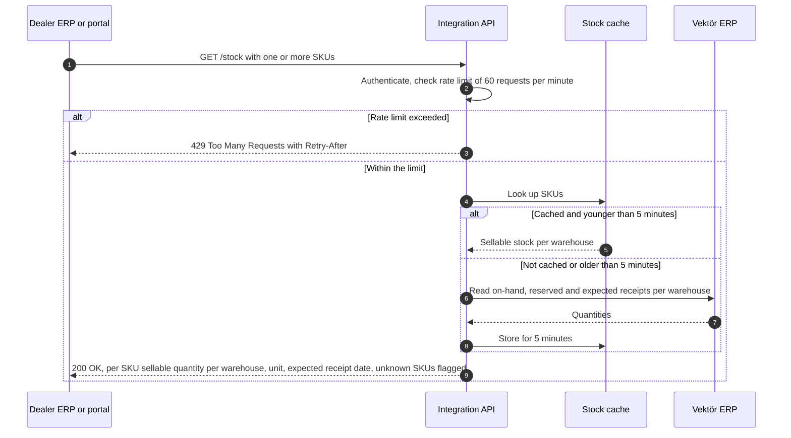
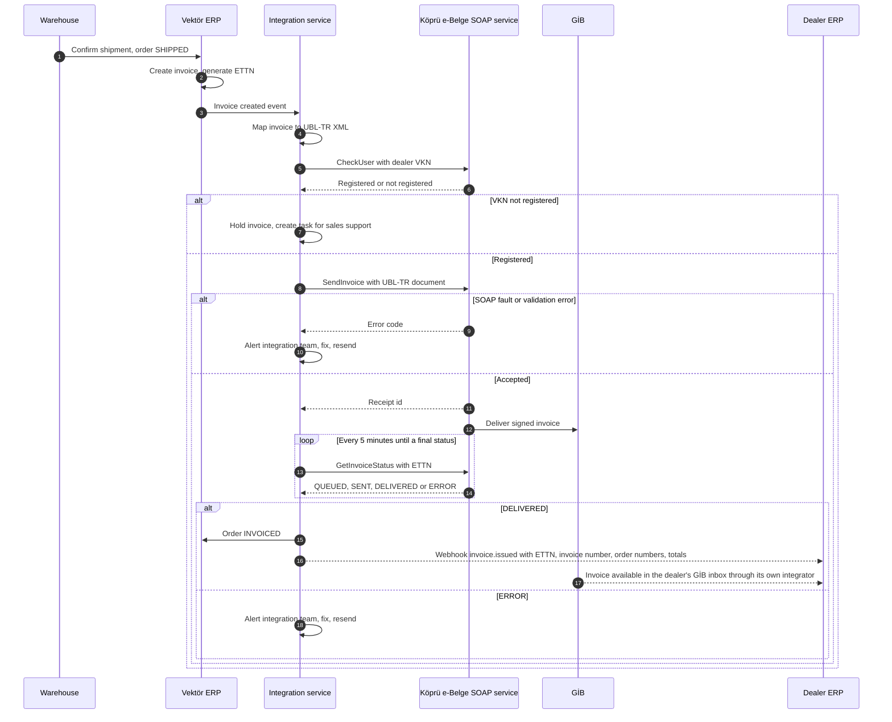
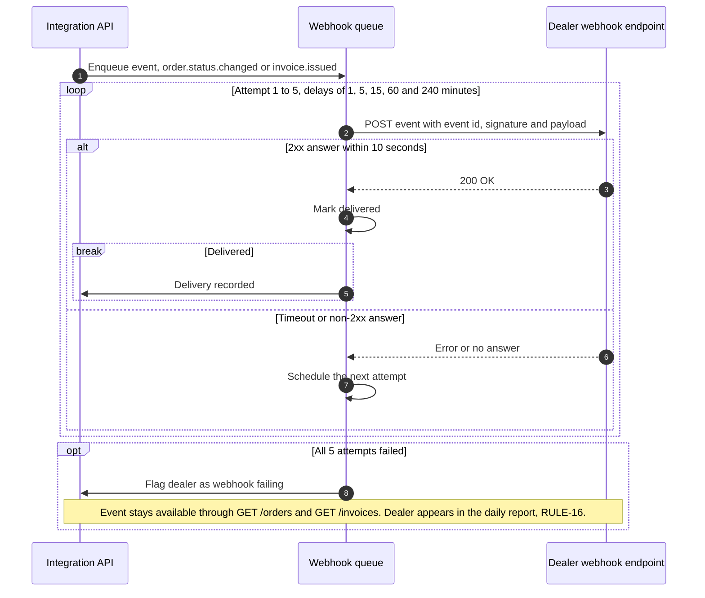
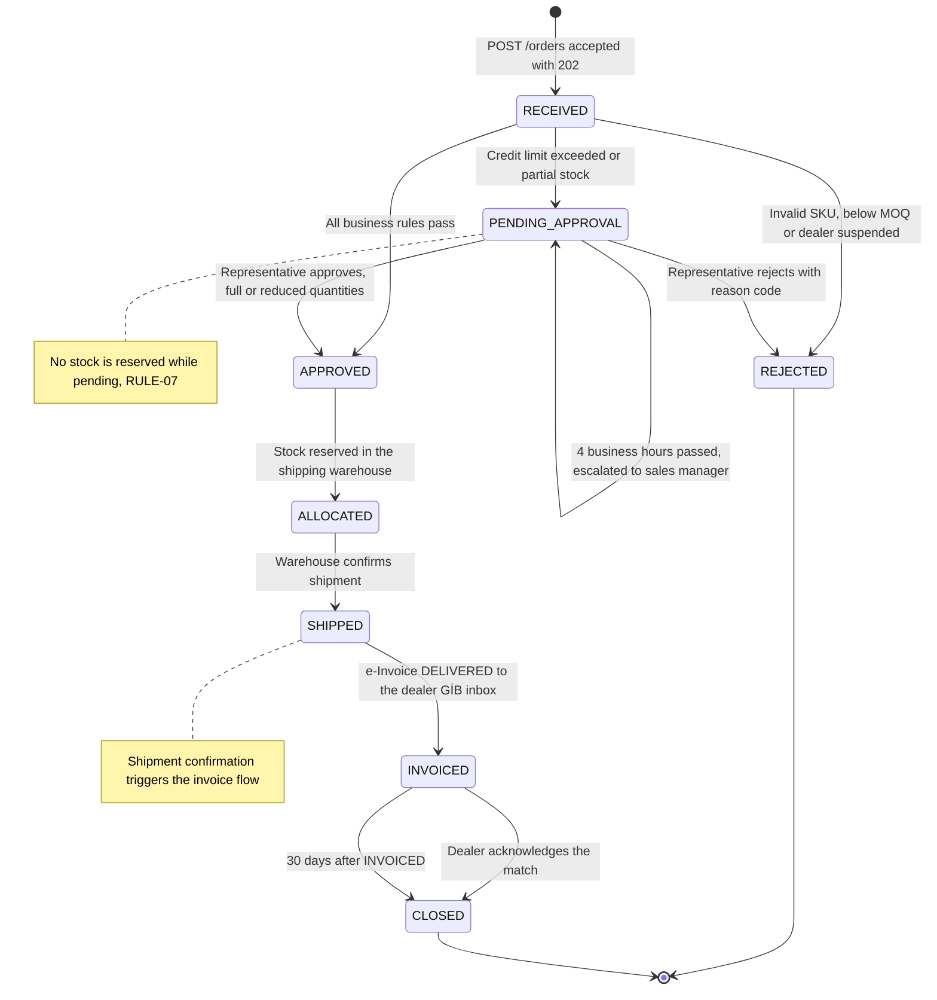
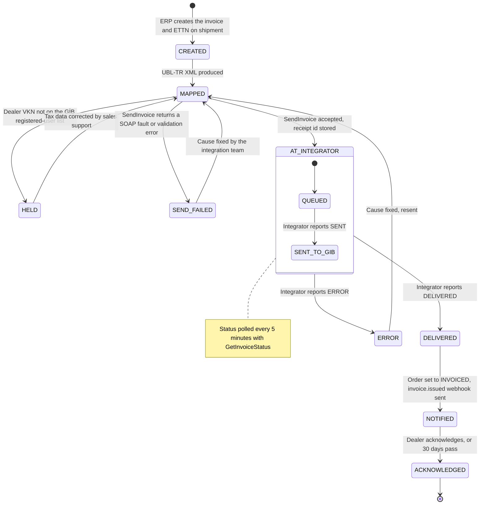

# Use Cases and UML Models

## B2B Order, Stock and Invoice Integration

| | |
|---|---|
| **Project** | B2B Order, Stock and Invoice Integration |
| **Document** | Use cases and UML models, version 1.0 |
| **Status** | Approved |
| **Author** | Sura Karaali, Business Analyst |
| **Date** | 29 October 2026 |
| **Related documents** | [01 BRD](01_brd.md), [02 Process analysis](02_process_as_is_to_be.md), [04 Field mapping](04_field_mapping.md), [05 Error scenarios](05_error_scenarios.md) |
| **Diagrams** | `diagrams/uml/` (use case diagram as draw.io and PNG, sequence and state diagrams as Mermaid `.mmd` files, also embedded below) |

> All companies, people and figures in this document are fictional. They were created for this portfolio case and are consistent with the [BRD](01_brd.md).

---

## 1. Purpose and scope

This document translates the business requirements and the to-be process into use cases: who uses the integration layer, for what goal, and what happens step by step, including what goes wrong. It is the bridge between the [BRD](01_brd.md) and the API specification: every endpoint, error code and status in the OpenAPI file traces back to a use case here.

The system under analysis is the **Vektör integration layer**: the REST API, the dealer portal, the business rules, the webhook delivery and the integration service that talks to the e-Invoice integrator. The ERP, the integrator and the dealers' systems are outside the boundary and appear as actors.

Six use cases are written in full (main flow, alternative flows, exception flows). The other four, which are simple or mostly manual, are described in short form. Sequence diagrams show the interaction between systems for the four flows where the message exchange matters. State diagrams give the lifecycle of an order and of an invoice.

## 2. Actors

| Actor | Type | Description | Use cases |
|---|---|---|---|
| Dealer ERP | Primary, system | The ERP of a connected dealer (SAP Business One, Logo), calling the API through a connector | UC-01, UC-02, UC-03, UC-08 |
| Dealer portal user | Primary, human | Purchasing staff of a small dealer without an ERP, working in the Vektör dealer portal, which calls the same API | UC-01, UC-02, UC-03 |
| Sales representative | Primary, human | Owns a dealer portfolio; decides credit and stock exceptions | UC-04 |
| Sales manager | Primary, human | Decides escalated exceptions | UC-04 |
| Sales support | Primary, human | Dealer onboarding, tax data corrections, portal help | UC-07, UC-10 |
| Warehouse | Primary, human | Picks, packs, ships and confirms shipment in the ERP | UC-05 |
| Integration team | Primary, human | Operates the integration, handles integrator errors, reviews the daily report | UC-09, UC-06 exceptions |
| Finance | Primary, human | Reviews invoice exceptions and reconciliation | UC-09 |
| IT | Primary, human | Issues API credentials, registers webhook URLs | UC-10 |
| Vektör ERP | Secondary, system | System of record for products, prices, stock, credit, orders and invoices | UC-01, UC-02, UC-04, UC-05, UC-06 |
| Köprü e-Belge | Secondary, system | Private integrator; signs and delivers e-Invoices over SOAP | UC-06 |
| GİB | External, indirect | Receives invoices from the integrator and delivers them to the dealer's inbox; not called directly | UC-06, UC-08 |

## 3. Use case diagram

Source: `diagrams/uml/00_use_case_diagram.drawio`

Two relationships are shown explicitly. UC-04 **extends** UC-01: the review happens only when the automatic checks fail. UC-07 **extends** UC-06: the tax data correction happens only when the dealer's tax number is not on the GİB registered-user list. Shipment confirmation (UC-05) triggers UC-06, which is a sequence in the process, not a UML relationship, so it is shown in the process model and in the sequence diagram instead.

## 4. Use case catalogue

| ID | Use case | Primary actor | Goal | Trigger | Priority | Requirements |
|---|---|---|---|---|---|---|
| UC-01 | Submit order | Dealer ERP, dealer portal user | Get an order accepted and approved without re-keying | Dealer needs to restock | Must | BR-01, BR-02, BR-03, BR-04, BR-05 |
| UC-02 | Query stock | Dealer ERP, dealer portal user | Know what can be delivered before ordering | Dealer prepares an order | Must | BR-07, BR-13 |
| UC-03 | Track order status | Dealer ERP, dealer portal user | Know where an order stands without calling | Status change, or dealer query | Must | BR-06 |
| UC-04 | Review pending order | Sales representative, sales manager | Decide a credit or stock exception quickly and with a record | Order enters `PENDING_APPROVAL` | Must | BR-05, BR-12 |
| UC-05 | Confirm shipment | Warehouse | Record that goods left, so invoicing and notification start | Goods picked and packed | Must | BR-08 |
| UC-06 | Issue e-invoice | Integration service | Deliver a correct e-Fatura to the dealer automatically | Order `SHIPPED` | Must | BR-08, BR-09 |
| UC-07 | Correct dealer tax data | Sales support | Unblock a held invoice | Invoice `HELD` | Must | BR-08 |
| UC-08 | Match incoming invoice | Dealer ERP | Book the invoice against the order automatically | `invoice.issued` webhook | Must | BR-09, BR-14 |
| UC-09 | Review daily exception report | Integration team, finance | Catch stalled orders, invoices and failing webhooks | Daily report | Must | BR-10 |
| UC-10 | Onboard dealer | IT, sales support | Connect a dealer to the API or the portal | Dealer signs the integration agreement | Should | BR-11 |

## 5. Detailed use cases

### UC-01 Submit order

| | |
|---|---|
| **Primary actor** | Dealer ERP, or dealer portal user through the portal |
| **Secondary actors** | Vektör ERP; sales representative in the exception path |
| **Goal** | The dealer's order is accepted, validated and approved with no manual re-keying |
| **Trigger** | The dealer system calls `POST /orders` |
| **Preconditions** | Dealer is onboarded (UC-10) and active; dealer system holds a valid OAuth2 access token |
| **Postconditions, success** | Order exists with a Vektör order number and is `ALLOCATED` (stock reserved) or `PENDING_APPROVAL` (task created); every status change was sent as a webhook |
| **Postconditions, failure** | Either no order exists and the dealer received the error codes, or the order is `REJECTED` with a reason code |
| **Priority** | Must |
| **Requirements** | BR-01, BR-02, BR-03, BR-04, BR-05 |
| **Business rules** | RULE-01 to RULE-07, RULE-10 |
| **Diagrams** | Sequence 7.1, state 8.1 |

**Main flow**

1. The dealer system sends `POST /orders` with the dealer code, the dealer's own order number, the order lines (SKU and quantity), the delivery address, an `Idempotency-Key` header and the access token.
2. The system authenticates the token and checks that the dealer is active (RULE-01).
3. The system validates the request against the schema: required fields, types, at least one line, positive quantities.
4. The system checks the `Idempotency-Key` against the keys stored for this dealer in the last 7 days (RULE-10).
5. The system stores the order as `RECEIVED` and answers `202 Accepted` with the Vektör order number, the status and the link to `GET /orders/{orderId}`.
6. The system runs the business rules: every SKU is active and in the dealer's price list (RULE-02), prices are taken from the price list (RULE-03), every line meets the minimum order quantity (RULE-04), open balance plus order total is within the credit limit (RULE-05), every line is fully available in the shipping warehouse (RULE-06).
7. All checks pass: the system sets `APPROVED`, asks the ERP to reserve the stock and sets `ALLOCATED` (RULE-07).
8. The system sends an `order.status.changed` webhook for each status change (UC-03).

**Alternative flows**

- **A1 Credit limit exceeded or stock partial** (step 6): the system sets `PENDING_APPROVAL` with reason `CREDIT_LIMIT` or `PARTIAL_STOCK`, creates a task for the dealer's sales representative and continues in UC-04. No stock is reserved.
- **A2 Duplicate request** (step 4): the system returns the stored response of the original request, with the same status code and body. Nothing is created. The use case ends.
- **A3 Portal user** (step 1): the dealer portal user fills the order form. The portal generates the `Idempotency-Key` and calls the same endpoint on the user's behalf.

**Exception flows**

- **E1 Authentication fails** (step 2): `401 Unauthorized`. Nothing is stored.
- **E2 Dealer suspended** (step 2): `403 Forbidden` with reason `DEALER_SUSPENDED`. Nothing is stored.
- **E3 Request invalid** (step 3): `400 Bad Request` with a list of error codes and field paths. Nothing is stored.
- **E4 Invalid SKU or quantity below minimum** (step 6): the order is set to `REJECTED` with reason `INVALID_SKU` or `BELOW_MOQ`, the webhook is sent, the use case ends.
- **E5 ERP unavailable** (step 6 or 7): the order stays `RECEIVED`; the rules run again when the ERP answers. If the ERP does not answer within 15 minutes the integration team is alerted. The dealer already has an order number.

**Open issues**: BRD Q2, backorder policy for partially available lines.

### UC-02 Query stock

| | |
|---|---|
| **Primary actor** | Dealer ERP, or dealer portal user through the portal |
| **Secondary actors** | Vektör ERP |
| **Goal** | The dealer knows the sellable quantity per warehouse before placing an order |
| **Trigger** | The dealer system calls `GET /stock` |
| **Preconditions** | Dealer is onboarded and active; valid access token |
| **Postconditions, success** | The dealer system holds the sellable quantities per SKU and warehouse, at most 5 minutes old |
| **Postconditions, failure** | The dealer system received an error code and can retry after the indicated time |
| **Priority** | Must |
| **Requirements** | BR-07, BR-13 |
| **Business rules** | RULE-11, RULE-12 |
| **Diagrams** | Sequence 7.2 |

**Main flow**

1. The dealer system sends `GET /stock` with up to 50 SKUs.
2. The system authenticates the token and checks the dealer's request rate against the limit of 60 requests per minute (RULE-11).
3. For each SKU the system takes the sellable quantity per warehouse (on hand minus reserved) from the cache if the entry is younger than 5 minutes, otherwise it reads the ERP and refreshes the cache.
4. The system answers `200 OK` with, per SKU, the sellable quantity per warehouse, the unit and the expected receipt date when a purchase order is open (BR-13). Unknown SKUs are returned flagged as `UNKNOWN` (RULE-12).

**Alternative flows**

- **A1 More than 50 SKUs** (step 1): `400 Bad Request` with reason `TOO_MANY_SKUS`. The dealer system splits the request.
- **A2 Portal user** (step 1): the portal shows the sellable quantity on the product search screen and on the order form, using the same endpoint.

**Exception flows**

- **E1 Rate limit exceeded** (step 2): `429 Too Many Requests` with a `Retry-After` header. Nothing else happens.
- **E2 ERP unavailable and no cached entry** (step 3): `503 Service Unavailable` with `Retry-After`. SKUs that are cached are not returned partially; the whole request fails, so the dealer never mixes fresh and missing data.

### UC-03 Track order status

| | |
|---|---|
| **Primary actor** | Dealer ERP, or dealer portal user through the portal |
| **Secondary actors** | None |
| **Goal** | The dealer always knows the current status of an order without calling anyone |
| **Trigger** | A status change on the Vektör side, or a query by the dealer system |
| **Preconditions** | Order exists; for webhooks, the dealer registered a webhook URL during onboarding (UC-10) |
| **Postconditions, success** | The dealer system holds the current status and reason code; delivery of the event is recorded |
| **Postconditions, failure** | The event is recorded as undelivered, the dealer is flagged, the status remains available by query |
| **Priority** | Must |
| **Requirements** | BR-06 |
| **Business rules** | RULE-09 (reduced quantities reported), RULE-16 |
| **Diagrams** | Sequence 7.4, state 8.1 |

**Main flow**

1. On every status change the system creates an `order.status.changed` event with the Vektör order number, the dealer order number, the previous and the new status, the reason code if any, the approved quantities per line when they differ from the requested ones, and the timestamp.
2. The system delivers the event to the dealer's registered webhook URL with an event id and a signature, and retries on failure (RULE-16).
3. The dealer system answers `2xx` and updates its own order.
4. At any time the dealer system can call `GET /orders/{orderId}`, or `GET /orders` filtered by dealer order number or status, to read the current status and the status history.

**Alternative flows**

- **A1 No webhook URL registered** (step 2): no event is sent; the dealer system polls `GET /orders`.
- **A2 Portal user**: the portal order list shows the status and the history; no webhook is involved.

**Exception flows**

- **E1 All delivery attempts fail** (step 2): the dealer is flagged as "webhook failing", the event stays available through the query endpoints, and the dealer appears in the daily report (UC-09).

### UC-04 Review pending order

| | |
|---|---|
| **Primary actor** | Sales representative; sales manager when escalated |
| **Secondary actors** | Vektör ERP; dealer system is notified |
| **Goal** | A credit or stock exception is decided within 4 business hours, with a recorded reason |
| **Trigger** | An order enters `PENDING_APPROVAL` and a task is created (UC-01 A1) |
| **Preconditions** | The representative is assigned to the dealer; the task is open |
| **Postconditions, success** | Order is `ALLOCATED` (approved, stock reserved) or `REJECTED`; the decision, the decider, the time and the reason are recorded; the dealer was notified |
| **Postconditions, failure** | The order stays `PENDING_APPROVAL` and the task is escalated |
| **Priority** | Must |
| **Requirements** | BR-05, BR-12 |
| **Business rules** | RULE-05, RULE-06, RULE-07, RULE-08, RULE-09 |
| **Diagrams** | Sequence 7.1, state 8.1 |

**Main flow**

1. The representative opens the task and sees the order lines, the reason code, the credit data (limit, open balance, order total including VAT), the sellable stock per line and the dealer's recent order history.
2. The representative approves the order.
3. The system sets `APPROVED`, asks the ERP to reserve the stock, sets `ALLOCATED` and sends the status webhook (UC-03).
4. The system closes the task and records the decision.

**Alternative flows**

- **A1 Approve with reduced quantities** (step 2, BR-12): the representative lowers the quantity on one or more lines. The system recalculates the order total, re-runs the credit and stock checks and, if they pass, continues at step 3. The webhook carries the approved quantities (RULE-09).
- **A2 Reject** (step 2): the representative chooses a reason code (`CREDIT_LIMIT_REJECTED`, `STOCK_UNAVAILABLE`, `OTHER` with a comment). The system sets `REJECTED`, sends the webhook and closes the task.
- **A3 Not decided within 4 business hours** (RULE-08): the system escalates the task to the sales manager and informs the representative. The manager decides as in step 2, A1 or A2.
- **A4 Credit data changed while pending**: a payment was posted and the open balance dropped. The representative re-runs the checks from the task; if they pass, the system continues at step 3 without a manual approval.

**Exception flows**

- **E1 Stock no longer available at approval** (step 3): the reservation fails for at least one line. The order returns to `PENDING_APPROVAL` with reason `PARTIAL_STOCK`, the task is reopened with the new quantities and the representative is informed.
- **E2 ERP unavailable** (step 3): the decision is stored, the order is `APPROVED`, and the reservation is retried until the ERP answers. `ALLOCATED` is set only when the reservation is confirmed.

### UC-06 Issue e-invoice

| | |
|---|---|
| **Primary actor** | Integration service (system use case, runs without a human) |
| **Secondary actors** | Vektör ERP, Köprü e-Belge, GİB (indirect); sales support in A1, integration team in the exception flows |
| **Goal** | A correct e-Fatura reaches the dealer's GİB inbox and the dealer is told about it with the ETTN |
| **Trigger** | The order becomes `SHIPPED` (UC-05) |
| **Preconditions** | Dealer master data holds the tax number; the integrator credentials are valid |
| **Postconditions, success** | Invoice `DELIVERED` at the integrator, order `INVOICED`, `invoice.issued` webhook delivered or queued, delivery time recorded |
| **Postconditions, failure** | Invoice is `HELD`, `SEND_FAILED` or `ERROR` with the cause recorded and a task or alert raised; the order stays `SHIPPED` |
| **Priority** | Must |
| **Requirements** | BR-08, BR-09 |
| **Business rules** | RULE-13, RULE-14, RULE-15, RULE-16 |
| **Diagrams** | Sequence 7.3, state 8.2 |

**Main flow**

1. The ERP creates the invoice for the shipment and generates the ETTN (RULE-13).
2. The integration service receives the invoice-created event and reads the invoice header and lines from the ERP.
3. The service maps the invoice to a UBL-TR document ("Temel" profile, sales invoice type) using the [field mapping](04_field_mapping.md).
4. The service validates the document against the UBL-TR schema and business rules locally.
5. The service checks the dealer's tax number against the GİB registered-user list through the integrator (RULE-14).
6. The service calls `SendInvoice`, stores the receipt id and sets the invoice to `AT_INTEGRATOR`.
7. The service polls `GetInvoiceStatus` by ETTN every 5 minutes until the status is final.
8. On `DELIVERED` the service sets the order to `INVOICED` (RULE-15), sends the `invoice.issued` webhook with the ETTN, invoice number, invoice date, both order numbers and the totals, and records the delivery time.

**Alternative flows**

- **A1 Tax number not registered** (step 5): the invoice is set to `HELD` and a task is created for sales support (UC-07). After the correction the flow resumes at step 3.

**Exception flows**

- **E1 Local validation fails** (step 4): invoice `SEND_FAILED`, the integration team is alerted with the validation messages. After the mapping or the data is fixed, the flow resumes at step 3.
- **E2 `SendInvoice` returns an error** (step 6): invoice `SEND_FAILED`, the team is alerted with the error code. Resume at step 3 after the fix.
- **E3 Integrator reports `ERROR`** (step 7): the team is alerted with the integrator's message, the cause is fixed and the invoice is resent according to the integrator's rules.
- **E4 Integrator unreachable** (step 5 to 7): the call is retried every 5 minutes; after 30 minutes the team is alerted; invoices queue in `MAPPED`.
- **E5 No final status within 24 hours** (step 7): the invoice is listed in the daily report (UC-09).

### UC-08 Match incoming invoice

| | |
|---|---|
| **Primary actor** | Dealer ERP |
| **Secondary actors** | Dealer's own integrator, Vektör integration API |
| **Goal** | The dealer books the invoice against the right order without typing anything |
| **Trigger** | The `invoice.issued` webhook arrives |
| **Preconditions** | The dealer system receives webhooks (UC-10); the dealer has a GİB inbox through its own integrator |
| **Postconditions, success** | Invoice booked and linked to the purchase order in the dealer ERP; order `CLOSED` on the Vektör side |
| **Postconditions, failure** | Invoice not booked; the mismatch is raised to Vektör |
| **Priority** | Must |
| **Requirements** | BR-09, BR-14 |
| **Business rules** | RULE-15, RULE-16 |
| **Diagrams** | Sequence 7.3, state 8.1 |

**Main flow**

1. The dealer system receives the `invoice.issued` webhook with the ETTN, invoice number, invoice date, Vektör order number, dealer order number, net amount, VAT amount, gross amount and currency.
2. The dealer system downloads the UBL-TR invoice from its own integrator's inbox by ETTN.
3. The dealer system finds its purchase order by the dealer order number and checks the totals of the UBL document against the webhook.
4. The dealer system books the invoice against the purchase order.
5. The dealer system calls `POST /invoices/{ettn}/acknowledge` (BR-14, optional). The system sets the order to `CLOSED`.

**Alternative flows**

- **A1 Invoice not yet in the inbox** (step 2): GİB delivery to the dealer's integrator can lag by minutes. The dealer system retries the download for up to 24 hours.
- **A2 Portal dealer**: the portal lists issued invoices with the ETTN; the dealer downloads the document from its integrator's portal and books it by hand.
- **A3 No acknowledgement** (step 5): the order is set to `CLOSED` automatically 30 days after `INVOICED`.

**Exception flows**

- **E1 Totals differ** (step 3): the dealer system does not book and raises a query through sales support. Vektör checks the invoice and the mapping; a corrected invoice follows the integrator's correction rules.
- **E2 ETTN not found after 24 hours** (step 2): the dealer contacts sales support; the integration team checks `GetInvoiceStatus` and the dealer's registered inbox address.

## 6. Short-form use cases

### UC-05 Confirm shipment

The warehouse picks and packs an `ALLOCATED` order, enters the delivery note number and the carrier tracking number in the ERP and confirms the shipment. The ERP sets the order to `SHIPPED`; the integration layer sends the status webhook (UC-03) and starts UC-06. The confirmation must be entered on the day of shipment, because it now drives invoicing and the dealer's notification. Partial shipments are out of scope in this version: an order ships in one go.

### UC-07 Correct dealer tax data

Sales support receives a task for an invoice `HELD` because the dealer's tax number is not on the GİB registered-user list (RULE-14). Sales support confirms the tax number and the e-Invoice registration with the dealer, corrects the dealer master data in the ERP and marks the task as resolved. The integration service re-runs the check and continues UC-06 from the mapping step. If the dealer is not an e-Invoice taxpayer at all, which contradicts the project assumptions, the invoice is escalated to finance.

### UC-09 Review daily exception report

Every morning the integration team and finance receive a report with five groups: orders `SHIPPED` for more than 1 working day without an invoice, invoices not `DELIVERED` within 24 hours of sending, invoices `DELIVERED` but not acknowledged within 5 working days, dealers whose webhooks failed all attempts, and shipments confirmed more than 1 day after the carrier pickup. Each line links to the order or invoice and to the integration log. The integration team handles technical causes, finance handles invoice content, sales support contacts dealers. The queries behind the report are in `sql/`.

### UC-10 Onboard dealer

IT creates the dealer's OAuth2 client in the test environment and later in production. Sales support assigns the price list, the shipping warehouse and, with finance, the credit limit in the ERP, and records the dealer's tax number and GİB inbox address. The dealer registers its webhook URL and runs the connection test with the published Postman collection against the test environment. When the test orders and a test invoice pass, IT activates the production credentials. Portal dealers skip the connector steps and receive portal accounts instead.

## 7. Sequence diagrams

### 7.1 Submit order

Source: `diagrams/uml/seq_01_submit_order.mmd`

### 7.2 Query stock

Source: `diagrams/uml/seq_02_query_stock.mmd`

### 7.3 Issue e-invoice

Source: `diagrams/uml/seq_03_issue_einvoice.mmd`

### 7.4 Webhook delivery with retries

Source: `diagrams/uml/seq_04_webhook_delivery.mmd`

## 8. State diagrams

### 8.1 Order lifecycle

The states match the BRD status table (section 7.5). Schema-invalid requests never create an order, so they do not appear here.

Source: `diagrams/uml/state_01_order.mmd`

### 8.2 Invoice lifecycle

The states on the Vektör side. `AT_INTEGRATOR` wraps the statuses reported by Köprü e-Belge.

Source: `diagrams/uml/state_02_invoice.mmd`

## 9. Traceability

| Use case | Requirements | Business rules | Diagrams | API elements (to be specified) |
|---|---|---|---|---|
| UC-01 Submit order | BR-01, BR-02, BR-03, BR-04, BR-05 | RULE-01 to RULE-07, RULE-10 | Sequence 7.1, state 8.1 | `POST /orders`, error codes, `Idempotency-Key` |
| UC-02 Query stock | BR-07, BR-13 | RULE-11, RULE-12 | Sequence 7.2 | `GET /stock`, `429`, `Retry-After` |
| UC-03 Track order status | BR-06 | RULE-09, RULE-16 | Sequence 7.4, state 8.1 | `GET /orders/{orderId}`, `GET /orders`, `order.status.changed` webhook |
| UC-04 Review pending order | BR-05, BR-12 | RULE-05 to RULE-09 | Sequence 7.1, state 8.1 | Internal task API, reason codes |
| UC-05 Confirm shipment | BR-08 | RULE-13 | State 8.1 | ERP event |
| UC-06 Issue e-invoice | BR-08, BR-09 | RULE-13 to RULE-16 | Sequence 7.3, state 8.2 | SOAP `CheckUser`, `SendInvoice`, `GetInvoiceStatus`; `invoice.issued` webhook |
| UC-07 Correct dealer tax data | BR-08 | RULE-14 | State 8.2 | Internal task |
| UC-08 Match incoming invoice | BR-09, BR-14 | RULE-15, RULE-16 | Sequence 7.3, state 8.1 | `invoice.issued` payload, `POST /invoices/{ettn}/acknowledge`, `GET /invoices` |
| UC-09 Review daily exception report | BR-10 | RULE-16 | None | SQL in `sql/` |
| UC-10 Onboard dealer | BR-11 | RULE-01 | None | OAuth2 client, webhook registration |

## 10. Open points

| ID | Point | Owner | Needed by |
|---|---|---|---|
| U1 | Should the portal allow sales support to enter an order on behalf of a dealer during the transition (process analysis P2)? If yes, it is a variant of UC-01 with an extra actor. | Sales Operations | API design |
| U2 | Is `POST /invoices/{ettn}/acknowledge` needed, or is the 30-day automatic close enough (BRD Q5)? | Sales Operations | API design |
| U3 | Partial shipments: the warehouse currently ships an order in one go. If split shipments are allowed later, UC-05 and UC-06 need one invoice per shipment and the order state model needs a `PARTIALLY_SHIPPED` state. | Logistics | Next version |
| U4 | Does the integrator expose a registered-user check as a separate operation, or must the check use the GİB list downloaded daily? | IT | API design |
